# Прізвище_nosql_3 — граф знань для рекомендацій (MovieLens 1M + Neo4j)

Графова модель MovieLens 1M у Neo4j: схема, батчеве завантаження 1M оцінок, Cypher-запити від фільтрацій до рекомендацій і шляхів, супервузли, алгоритми GDS (PageRank, Louvain, Dijkstra) і порівняння з реляційним підходом.

> Усі числа нижче — з реального прогону (Neo4j 5.18.1, APOC 5.18.0, GDS 2.6.9, Docker Desktop, Windows 11). Скриншоти — у `screenshots/`.

---

## 1. Запуск з нуля (локально, Docker)

Потрібно: Docker Desktop, Python 3.10+, ~8 ГБ RAM (heap Neo4j налаштований на 4 ГБ, на машині з 8 ГБ зменшіть до `2G` у `docker-compose.yml`).

```bash
# 1. Дані: завантажить ml-1m.zip (~6 МБ), розпакує й конвертує .dat → import/*.csv
python convert.py

# 2. Neo4j 5.18 + APOC + GDS (перший старт ~1–2 хв: контейнер качає плагіни)
docker compose up -d
docker logs -f neo4j_movielens          # чекаємо рядок "Started."

# 3. Завантаження (~2–4 хв)
docker exec -i neo4j_movielens cypher-shell -u neo4j -p password123 -f /queries/part2_load.cypher

# 4. Запити
docker exec -i neo4j_movielens cypher-shell -u neo4j -p password123 -f /queries/part3.cypher
docker exec -i neo4j_movielens cypher-shell -u neo4j -p password123 -f /queries/part4_supernodes.cypher
docker exec -i neo4j_movielens cypher-shell -u neo4j -p password123 -f /queries/part5_gds.cypher   # необов'язково
```
Neo4j Browser: http://localhost:7474 (логін `neo4j`, пароль `password123`). Запити для скриншотів копіюються з `.cypher`-файлів по одному.

Усі скрипти ідемпотентні: `CREATE … IF NOT EXISTS`, `MERGE` для вузлів і ребер, `gds.graph.drop(…, false)` на старті частини 5.

**Нюанси Windows, на які натрапили при прогоні:**
- `convert.py` падає з `UnicodeEncodeError` на кириличному `print` у консолі cp1252 → запускати як `PYTHONIOENCODING=utf-8 python convert.py`.
- Якщо завантаження архіву падає з `CERTIFICATE_VERIFY_FAILED` (антивірус/проксі перехоплює HTTPS), скачайте `ml-1m.zip` вручну з [grouplens.org](https://grouplens.org/datasets/movielens/1m/) і розпакуйте в корінь проєкту (`ml-1m/ratings.dat`) — скрипт тоді пропускає завантаження.
- У Git Bash шлях `/queries/...` у `docker exec` перетворюється на `C:/Program Files/Git/queries/...` → перед командою `export MSYS_NO_PATHCONV=1` (у PowerShell проблеми немає).

### Що змінено відносно шаблонів умови
| Що | Шаблон | Тут | Чому |
|---|---|---|---|
| Пам'ять у `docker-compose.yml` | `NEO4J_dbms_memory_heap_*` | `NEO4J_server_memory_heap_*` + pagecache | У Neo4j 5 налаштування перейменовані на `server.memory.*`, старі імена — з 4.x |
| `convert.py` | Назва з роком в одному полі | `title` + `year` окремо, назви вікових груп і професій | Рік потрібен як число для фільтрів; не парсити рядок у кожному запиті |
| Індекси | — | Uniqueness constraints | Constraint = індекс + гарантія унікальності ключа |
| `id(n)` у частині 5 | `id(m1) < id(m2)` | `m1.movieId < m2.movieId` | `id()` deprecated у Neo4j 5 |
| Ребра CO_RATED / SIMILAR | Усі пари → `LIMIT 50000` | GDS Node Similarity (topK=10) | Див. розділ 6.0 |

### Структура
```
.
├── docker-compose.yml
├── convert.py                  # .dat (Latin-1, «::») → import/*.csv (UTF-8, «,»)
├── import/                     # movies.csv, users.csv, ratings.csv (генеруються)
├── queries/
│   ├── part2_load.cypher       # constraints/індекси + завантаження
│   ├── part3.cypher            # 6 запитів (+ допоміжні 1b, 2b, 6b–6d)
│   ├── part4_supernodes.cypher
│   └── part5_gds.cypher        # PageRank, Louvain, Dijkstra (необов'язково)
├── screenshots/                # schema.png, part3_q*.png, part5_*.png (Neo4j Browser)
└── README.md
```

---

## 2. Частина 1 — схема графа

```
                         (:Genre {name})
                               ▲
                               │ :HAS_GENRE
                               │ (1 фільм → 1–6 жанрів)
                               │
 (:User {userId, gender, age, ageGroup,      (:Movie {movieId, title, year})
         occupation, occupationName})                     ▲
          │                                               │
          └───────────── :RATED {rating, timestamp} ──────┘
                         (1 000 209 ребер)

 Обсяги: User 6 040 · Movie 3 883 · Genre 18 · RATED 1 000 209 · HAS_GENRE 6 408
 Тимчасові ребра частини 5:
   (:Movie)-[:CO_RATED {weight}]->(:Movie)        — схожість фільмів (Jaccard)
   (:User)-[:SIMILAR {weight, cost}]->(:User)     — схожість користувачів
```

`CALL db.schema.visualization()` після частини 2 (до GDS-ребер):

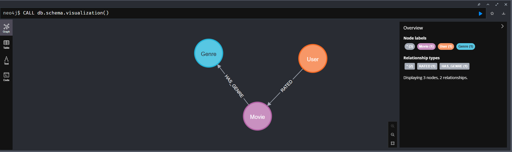

### 2.1. Що стало вузлами, а що — ребрами, і чому
**Вузли** — це сутності з власною ідентичністю, до яких сходяться зв'язки з різних боків: **User**, **Movie**, **Genre**. З кожної з них природно *починати* обхід: «фільми цього користувача», «користувачі цього фільму», «фільми цього жанру».
**Ребра** — дії й належність між сутностями: **RATED** (користувач оцінив фільм) і **HAS_GENRE** (фільм належить жанру). Вони не існують окремо від двох кінців.

Свідомо **не** зроблені вузлами: стать, вікова група, професія (21 значення) і рік. Це атрибути з дуже низькою кардинальністю, за якими ми фільтруємо й агрегуємо, але не *ходимо* графом. Окремий вузол `(:Occupation {name: "college/grad student"})` на сотні користувачів став би супервузлом, не давши жодного нового обходу. Якщо колись знадобляться демографічні рекомендації («що дивляться програмісти»), їх легко винести у вузли без зміни решти схеми.

### 2.2. Оцінка — ребро `RATED` чи вузол `Rating`?
Обрано **ребро** `(User)-[:RATED {rating, timestamp}]->(Movie)`.

| | Ребро `RATED` | Вузол `(:Rating)` |
|---|---|---|
| Хопів User → Movie | 1 | 2 (`User→Rating→Movie`) |
| Об'єктів на 1M оцінок | 1M ребер | 1M вузлів + 2M ребер |
| Запити | `(u)-[r:RATED]->(m)` | `(u)-[:GAVE]->(r:Rating)-[:FOR]->(m)` — довші, в обходах на 4–6 кроків особливо |
| Кілька оцінок однієї пари | Незручно (кілька паралельних ребер) | Природно (історія переоцінок) |
| Зв'язки *від* оцінки | Неможливі: ребро не може бути кінцем іншого ребра | Можна: `(Rating)-[:IN_CONTEXT]->(Device)`, теги, відгук, лайки відгуку |

У MovieLens 1M у кожної пари «користувач–фільм» рівно одна оцінка, і в неї лише дві властивості (`rating`, `timestamp`). Жодних зв'язків *від* оцінки немає. Тому вузол `Rating` подвоїв би довжину кожного обходу (а рекомендації й пошук шляхів — це саме обходи) і втричі збільшив би кількість об'єктів, нічого не давши натомість. Вузол виправданий, коли оцінка стає повноцінною сутністю: має текст відгуку, коментарі, контекст перегляду, повторні оцінки в часі або на неї треба посилатися з інших місць (гіперребро). Додатковий аргумент за ребро: Neo4j 5 вміє індексувати властивості ребер (`CREATE INDEX FOR ()-[r:RATED]-() ON (r.rating)`). Раніше це був вагомий аргумент за вузол.

### 2.3. Чому жанри — окремі вузли, а не список у `Movie`
- **Обхід замість скану.** `(:Genre {name:'Thriller'})<-[:HAS_GENRE]-(m)` — це пошук одного вузла через індекс і прохід лише по його ~490 фільмах. Зі списком `m.genres` довелося б перебрати всі 3 883 фільми і для кожного перевіряти `'Thriller' IN m.genres`: range-індекс не індексує окремі елементи списку.
- **Жанр — точка з'єднання.** Через жанр фільми пов'язані між собою: «схожі фільми того самого жанру», «улюблені жанри користувача» (`User→Movie→Genre`), жанровий профіль спільноти Louvain (частина 5). Зі списком ці запити перетворюються на розпаковування рядків.
- **Немає дублювання й опечаток.** Назва жанру зберігається один раз, а uniqueness constraint гарантує, що «Sci-Fi» і «SciFi» не співіснують. До жанру можна додати властивості (опис, агреговану статистику, див. 7.3).
- **Ціна:** жанрові вузли — кандидати в супервузли (Drama ≈ 1 600 фільмів, а через них — третина всіх оцінок). Див. Частину 4.

---

## 3. Частина 2 — завантаження (`queries/part2_load.cypher`)

| # | Запит | Що робить і чому так |
|---|---|---|
| 0 | `CREATE CONSTRAINT … REQUIRE u.userId IS UNIQUE` (×3), `CREATE INDEX` по `Movie.year` і `RATED.rating`, `db.awaitIndexes` | Constraint автоматично створює range-індекс, тож кожен `MERGE`/`MATCH` за ключем — це пошук в індексі, а не скан усіх вузлів лейбла. Створюються **до** завантаження: інакше `MERGE` для кожного з мільйона рядків сканував би лейбл. `awaitIndexes` гарантує, що індекси ONLINE до першого запиту. |
| 1 | `LOAD CSV … MERGE (u:User {userId}) SET …` | 6 040 рядків — одна транзакція, батчі не потрібні. `MERGE` лише за ключем, а решта властивостей через `SET`. Якщо покласти всі властивості в `MERGE`, повторний запуск зі зміненою властивістю створив би дублікат. `toInteger()` — бо `LOAD CSV` читає все як рядки. |
| 2 | `LOAD CSV … MERGE (m:Movie) … UNWIND split(row.genres,'\|') … MERGE (g:Genre) MERGE (m)-[:HAS_GENRE]->(g)` | Фільм, його жанри й ребра — за один прохід. `split` + `UNWIND` перетворює `"Action\|Thriller"` на окремі рядки. `MERGE` для жанру створює кожен із 18 жанрів рівно один раз. |
| 3 | `apoc.periodic.iterate(LOAD CSV …, MATCH u, MATCH m, MERGE (u)-[:RATED]->(m) SET …, {batchSize:10000, parallel:false})` | 1M ребер в одній транзакції не вмістяться в heap. Перший запит стрімить рядки, другий виконується батчами по 10 000 у **окремих транзакціях**. `MATCH` для вузлів: вони вже існують, і це найдешевший пошук по унікальному індексу. `MERGE` для ребра — захист від подвоєння при повторному запуску. `parallel:false` — паралельні батчі беруть блокування на ті самі популярні фільми й можуть впасти з deadlock. |
| 4 | `count()` по лейблах/типах + `SHOW INDEXES` | Звірка з очікуваними 6 040 / 3 883 / 18 / 1 000 209. |

Вивід перевірки (`cypher-shell --format plain`):
```
batches, total,   timeTaken, committedOperations, failedOperations, errorMessages
101,     1000209, 54,        1000209,             0,                {}

users 6040 · movies 3883 · genres 18 · ratings 1000209 · has_genre 6408

name,             type,     entityType,     labelsOrTypes, properties,  state
"genre_name",     "RANGE",  "NODE",         ["Genre"],     ["name"],    "ONLINE"
"index_343aff4e", "LOOKUP", "NODE",         NULL,          NULL,        "ONLINE"
"index_f7700477", "LOOKUP", "RELATIONSHIP", NULL,          NULL,        "ONLINE"
"movie_id",       "RANGE",  "NODE",         ["Movie"],     ["movieId"], "ONLINE"
"movie_year",     "RANGE",  "NODE",         ["Movie"],     ["year"],    "ONLINE"
"rated_rating",   "RANGE",  "RELATIONSHIP", ["RATED"],     ["rating"],  "ONLINE"
"user_id",        "RANGE",  "NODE",         ["User"],      ["userId"],  "ONLINE"
```
- Усі обсяги збіглися з очікуваними, `failedOperations = 0`.
- `apoc.periodic.iterate`: **54 с** на 1 000 209 ребер (101 батч по 10 000, ≈ 18.5 тис. ребер/с); увесь скрипт разом з індексами — 1 хв 04 с.
- Два `LOOKUP`-індекси Neo4j створює сам (пошук за лейблом / типом ребра); решта — наші 3 constraint-и + 2 індекси.

---

## 4. Частина 3 — запити (`queries/part3.cypher`)

> Скриншоти — перші 10 рядків результату кожного запиту з Neo4j Browser. Весь `part3.cypher` виконується за ~8 с.

### Запит 1. Thriller із середнім рейтингом > 4.0
Старт з одного вузла `Genre {name:'Thriller'}` (індекс), обхід до його фільмів і їхніх оцінок, агрегація `avg`/`count` по фільму, потім фільтр по агрегату. Додано поріг **≥ 30 оцінок** як страховку від фільмів з 1–2 оцінками «5», у яких «середній рейтинг» нічого не означає.

**Результат:** 52 фільми. Топ: *The Usual Suspects* 4.52 (1 783 оцінки), *A Close Shave* 4.52 (657), *Rear Window* 4.48, *The Third Man* 4.45, *The Sixth Sense* 4.41, далі Хічкок, *Chinatown*, *The Matrix*.

**Порівняння з 1b (без порогу):** очікувалось, що без порогу вилізуть фільми з однією оцінкою. Насправді — ні: без порогу ті самі **52** фільми, мінімум **43** оцінки. Серед трилерів немає «рідкісних» фільмів із середнім > 4, тож для цього жанру поріг нічого не відсікає. Його залишено, бо для інших жанрів (Documentary, Film-Noir з малою кількістю оцінок) він потрібен.

**Мітки жанрів «зашумлені».** *A Close Shave* — це ляльковий мультфільм про Wallace & Gromit, але в MovieLens у нього мітки `Animation|Comedy|Thriller`, тому він ділить перше місце серед трилерів. Жанри в датасеті проставлені грубо й без ваги («трохи трилер» = «повністю трилер»), тож жанрові вибірки варто сприймати як наближення.

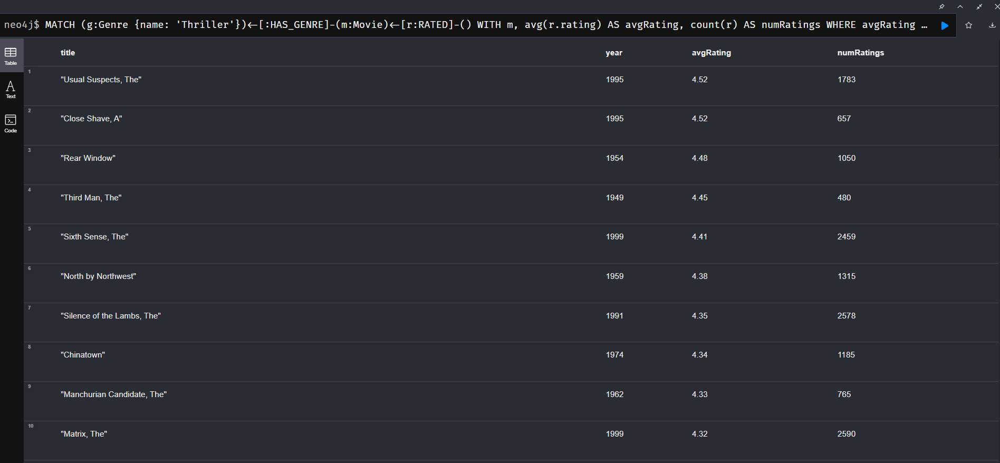

### Запит 2. Користувачі з > 50 оцінками «5»
Фільтр `r.rating = 5` **до** `count`: рахуємо лише потрібні ребра. Поріг `> 50` накладається на агрегат через `WITH … WHERE` (аналог `HAVING`). 2b повертає загальну кількість таких користувачів.

**Результат:** **1 390** користувачів (23 % від 6 040). Лідер — userId 4277 (M, 35–44, self-employed) з **571** «п'ятіркою»; у топ-25 майже лише чоловіки 25–44 років. Це ті самі «важкі» користувачі, що й у частині 4.

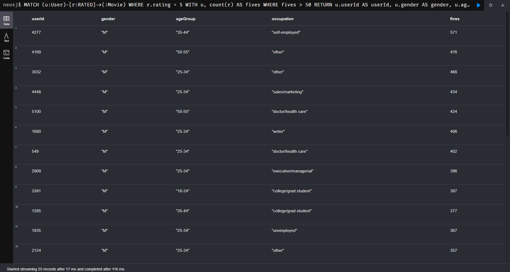
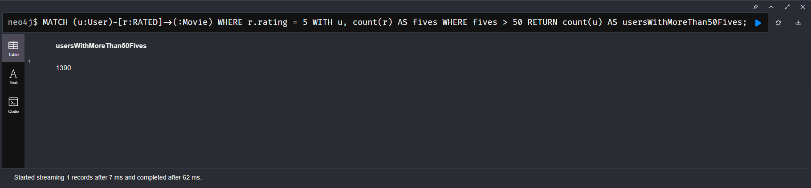

### Запит 3. Фільми, які userId=1 і userId=2 обидва оцінили ≥ 4
Один патерн `(u1)-[r1]->(m)<-[r2]-(u2)`: обидва кінці знаходяться через індекс, Neo4j перетинає їхні сусідства. Це по суті «спільні друзі» з соцмереж, тільки для фільмів.

**Результат:** 6 фільмів — *One Flew Over the Cuckoo's Nest* (5/5), *Awakenings* (5/4), *Dead Poets Society*, *Driving Miss Daisy*, *Saving Private Ryan*, *To Kill a Mockingbird*. Спільний смак — драми.

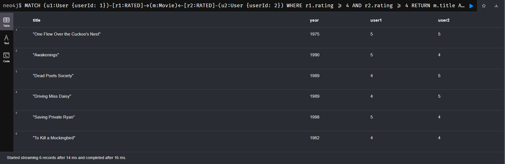

### Запит 4. Жанри зі стабільно високими оцінками
Для кожного жанру: середня оцінка, кількість оцінок, **stDev** (розкид) і **% оцінок ≥ 4**. «Стабільно» — це не лише високе середнє, а й малий розкид при великій вибірці. Фільм із кількома жанрами враховується в кожному.

**Результат** (очікування підтвердилось):

| Жанр | avg | оцінок | stDev | % ≥ 4 |
|---|---|---|---|---|
| Film-Noir | **4.075** | 18 261 | **0.933** | **76.3** |
| Documentary | 3.933 | 7 910 | 1.033 | 72.3 |
| War | 3.893 | 68 527 | 1.065 | 69.4 |
| Drama | 3.766 | 354 529 | 1.046 | 64.4 |
| … | | | | |
| Children's | 3.422 | 72 186 | 1.161 | 51.6 |
| Horror | **3.215** | 76 386 | **1.226** | **44.6** |

Найстабільніший — **Film-Noir**: найвище середнє *і* найменший розкид, але вибірка мала (1.8 % усіх оцінок). Якщо зважати на обсяг, найкращий компроміс — **War** і **Drama** (69–64 % високих оцінок на десятках і сотнях тисяч оцінок). Horror — внизу за всіма трьома метриками: найнижче середнє, найбільший розкид, менше половини оцінок ≥ 4.

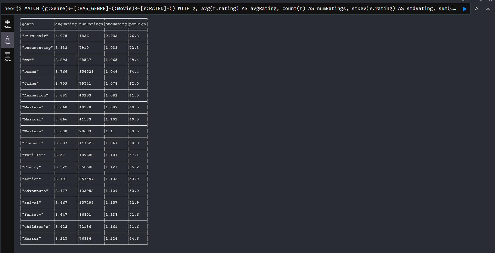

### Запит 5. «Користувачі зі схожими смаками також дивилися»
User-based collaborative filtering за 4 кроки:
1. **Сусіди:** хто високо (≥ 4) оцінив ті самі фільми, що й цільовий користувач. `commonHigh` — кількість таких збігів.
2. **50 найсхожіших.** Без `LIMIT` у кандидати потрапили б майже всі 6 000 користувачів через блокбастери, і рекомендація перетворилась би на «топ популярного».
3. **Кандидати:** їхні високо оцінені фільми, яких у цільового користувача **немає** (`NOT (me)-[:RATED]->(rec)`).
4. **Ранжування** за кількістю сусідів, що «проголосували» (`votes ≥ 5` відсікає випадкові збіги), потім за їхньою середньою оцінкою.

`WITH 1 AS targetId` замість `:param` — щоб той самий текст працював і в Browser, і в `cypher-shell`.

**Результат для userId=1** (F, Under 18, K-12 student; 53 оцінки, найчастіше Drama, Children's, Animation, Musical):

| # | Фільм | votes (з 50) | avg сусідів |
|---|---|---|---|
| 1 | The Shawshank Redemption (1994) | 47 | 4.70 |
| 2 | The Silence of the Lambs (1991) | 46 | 4.83 |
| 3 | Raiders of the Lost Ark (1981) | 46 | 4.70 |
| 4 | Star Wars V: The Empire Strikes Back (1980) | 45 | 4.69 |
| 5 | When Harry Met Sally... (1989) | 45 | 4.60 |
| … | It's a Wonderful Life, Shakespeare in Love, Indiana Jones III, As Good As It Gets | 43 | 4.42–4.91 |

**Чи правдоподібно?** За назвами рекомендації виглядають логічно, але ці фільми я не знаю настільки, щоб повноцінно оцінити їх за жанром і змістом. З даних видно одне: у списку немає жодного фільму з «дитячих» жанрів профілю, зате є трилер (*Silence of the Lambs*) для користувачки до 18 років. Це **перекіс у бік популярного**: 50 «сусідів» відібрані за *кількістю* спільних високих оцінок, тож виграють користувачі, які оцінили дуже багато фільмів, а їхні спільні улюблені — масово популярні фільми (*Star Wars V* — 3-й за кількістю оцінок у всьому датасеті, *Shawshank* — 24-й, *Raiders* — 12-й). Виправлення — нормувати схожість (Jaccard/косинус замість сирого `count`, як у частині 5) і знижувати вагу блокбастерів (див. 5.3, п. 4).

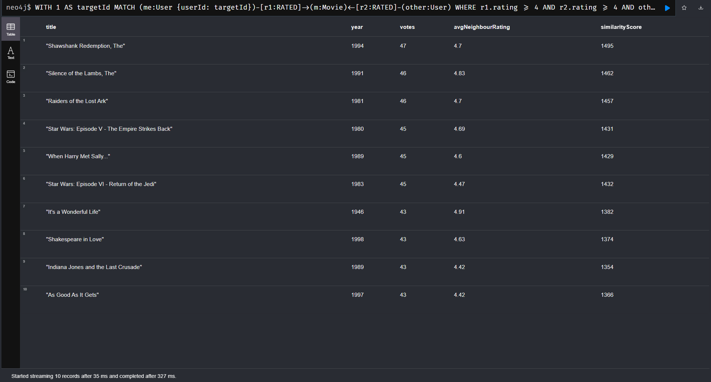

### Запит 6. Найкоротший ланцюжок між двома користувачами
`shortestPath((u1)-[:RATED*..6]-(u2))` без напрямку: користувач → фільм ← користувач → … Верхня межа `*..6` обов'язкова, інакше пошук у щільному графі може піти дуже далеко. Варіанти:
- **6b** — лише через високі оцінки (`all(r IN relationships(p) WHERE r.rating >= 4)`), тобто зв'язок через спільний *смак*, а не через перегляд;
- **6c/6d** — пошук користувача без жодного спільного фільму з userId=1 і довжина шляху до нього.

**Результати:**
| Варіант | Довжина | Ланцюжок |
|---|---|---|
| 6 (будь-які оцінки) | **2** | User 1 → *Awakenings* ← User 2 |
| 6b (лише ≥ 4) | **2** | той самий: обидва поставили *Awakenings* 5 і 4 |
| 6c | — | **140** користувачів (2.3 %) не мають жодного спільного фільму з userId=1 |
| 6d | **4** | User 1 → *Cinderella* ← User 536 → *Wes Craven's New Nightmare* ← User 46 |

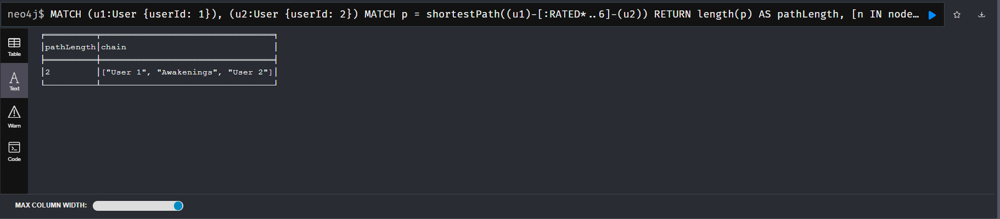
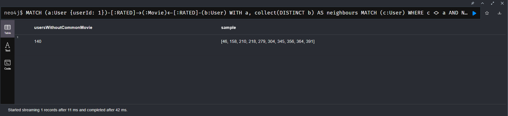
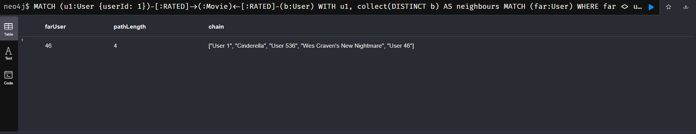

**Що означає довжина шляху?** Один хоп — одне ребро `RATED`, і шлях завжди парної довжини, бо чергуються User і Movie.
- **2** (`U1 → M ← U2`): користувачі оцінили *один і той самий фільм*. Прямий збіг.
- **4** (`U1 → M1 ← U3 → M2 ← U2`): спільного фільму немає, але є третій користувач, який має по спільному фільму з кожним. «Друг друга» за смаком.
- **6**: ланцюжок через двох проміжних користувачів і три фільми. Зв'язок дуже опосередкований, для рекомендацій майже нічого не значить.

**Важливе спостереження для цього датасету:** майже будь-яка пара має шлях довжини **2**. Кожен користувач оцінив ≥ 20 фільмів, а блокбастери на кшталт «American Beauty» (≈ 3.4 тис. оцінок) чи «Star Wars» оцінили більше половини користувачів. Сам факт шляху тут малоінформативний: його «закорочують» супервузли (Частина 4). Тому 6b (через високі оцінки) і граф `SIMILAR` (частина 5.3) дають змістовнішу відстань.

**Підтверджено, з уточненням:** для userId=1 довжина 2 справджується для **97.7 %** користувачів (5 899 з 6 039). Решта 140 не мають жодного спільного фільму, і до них шлях довжини **4** — через одного проміжного користувача (6d). Тобто «майже будь-яка пара» — це саме «майже»: для 2.3 % пар відстань щонайменше 4. Цікаво, що у прикладі 6d місток іде через *Cinderella* (дитячий профіль userId=1) до горору — зв'язок формально є, але про спільний смак він не говорить нічого.

---

## 5. Частина 4 — супервузли (`queries/part4_supernodes.cypher`)

| Запит | Що робить і чому так |
|---|---|
| Крок 1 (UNION ALL) | Розподіл ступенів (avg, медіана, p99, max) окремо для Movie, User, Genre. «Аномальний» має сенс лише відносно типового. `COUNT { (m)<-[:RATED]-() }` для щільних вузлів читає лічильник групи ребер, а не самі ребра, тож запит дешевий. |
| 1a / 1b | Топ-10 фільмів і користувачів за ступенем. |
| 1c | Жанри: прямий ступінь (фільми) і **досяжність**: скільки оцінок зачіпає обхід через жанр. |
| 1d | Формальний критерій: ступінь > μ + 3σ. |
| Крок 2 (PROFILE) | Однаковий 2-хоповий запит від супервузла і від «медіанного» фільму. Порівнюються db hits і кількість рядків. |

Весь `part4_supernodes.cypher` виконується за ~4 с.

**Крок 1 — розподіл ступенів:**
| Вузол | вузлів | avg | медіана | p99 | max |
|---|---|---|---|---|---|
| Movie (вхідні `RATED`) | 3 883 | 257.6 | 109 | 1 783 | **3 428** |
| User (вихідні `RATED`) | 6 040 | 165.6 | 96 | 909 | **2 314** |
| Genre (вхідні `HAS_GENRE`) | 18 | 356.0 | 211 | 1 603 | 1 603 |

**1a — топ фільмів:** American Beauty 3 428 · Star Wars IV 2 991 · Star Wars V 2 990 · Star Wars VI 2 883 · Jurassic Park 2 672 · Saving Private Ryan 2 653 · Terminator 2 2 649 · The Matrix 2 590 · Back to the Future 2 583 · The Silence of the Lambs 2 578.

**1b — топ користувачів:** userId 4169 — 2 314 оцінок, далі 1680 (1 850), 4277 (1 743), 1941 (1 595), 1181 (1 521) … 10-й — 1 286. 9 з 10 — чоловіки.

**1c — жанри: ступінь vs досяжність:**
| Жанр | фільмів | досяжних оцінок | % усіх оцінок |
|---|---|---|---|
| Drama | 1 603 | 354 529 | **35.4** |
| Comedy | 1 200 | 356 580 | **35.7** |
| Action | 503 | 257 457 | 25.7 |
| Thriller | 492 | 189 680 | 19.0 |
| … | | | |
| Documentary | 127 | 7 910 | 0.8 |
| Film-Noir | 44 | 18 261 | 1.8 |

**1d — формальний критерій μ + 3σ:** поріг **1 396** оцінок, йому відповідають **84** фільми (Toy Story, Twelve Monkeys, Babe, The Usual Suspects, Braveheart, Pulp Fiction, Shawshank, Forrest Gump, …).

**Крок 2 — PROFILE, той самий 2-хоповий запит:**
| | American Beauty (3 428 оцінок) | Bed of Roses (120 оцінок) | різниця |
|---|---|---|---|
| рядків після 2 хопів | 714 252 | 52 819 | **13.5×** |
| db hits | 1 029 474 | 106 385 | **9.7×** |
| час | 268 мс | 75 мс | 3.6× |
| план | `NodeHashJoin` + `Expand(All)` по **всіх** 1 000 209 ребрах | `Expand(All)` від вузла | |

### 5.1. Які вузли виявились супервузлами
Очікування підтвердилось за всіма трьома типами:
- **Фільми-блокбастери:** American Beauty — 3 428 оцінок (57 % усіх користувачів), Star Wars IV–VI, Jurassic Park, Saving Private Ryan, Terminator 2, The Matrix — по 2.6–3 тис. ребер при **медіані 109**, тобто у 24–31 раз більше за типовий фільм. За критерієм μ + 3σ супервузлів **84**.
- **«Важкі» користувачі:** 10 користувачів з 1.3–2.3 тис. оцінок при **медіані 96**. Рекордсмен userId 4169 оцінив 2 314 фільмів — 60 % каталогу.
- **Жанри:** прямий ступінь скромний (Drama 1 603 фільми, Comedy 1 200), але **через** кожен з них проходить понад третину всіх оцінок датасету (35.4 % і 35.7 %). Тобто жанри — супервузли не за ступенем, а за **досяжністю**, і будь-який запит «жанр → фільми → оцінки» по них зачіпає сотні тисяч ребер (запит 4 частини 3 у Browser — 1.3 с проти десятків–сотень мс у запитів 2, 3, 5).

### 5.2. Чому запит через супервузол повільніший при тих самих індексах
Індекс прискорює лише **пошук стартового вузла** (O(log n)). Далі йде обхід, і його вартість пропорційна **ступеню** вузла, а індекс тут не допомагає. (Уточнення: індексу по `Movie.title` у схемі немає, тож в обох запитах кроку 2 старт однаковий — `NodeByLabelScan` по 3 883 фільмах; уся різниця — в обході.)
- **Fan-out множиться з кожним хопом.** Від American Beauty — 3 428 користувачів × у середньому 209 їхніх оцінок = **714 тис. рядків**. Від «типового» фільму Bed of Roses — 52.8 тис., у **13.5 раза** менше (очікувалось 25–30×). Різниця менша, ніж відношення ступенів (28×), бо 120 глядачів «середнього» фільму самі дуже активні — у середньому **441** оцінка на людину проти 209 у глядачів блокбастера. Хто дивиться маловідомі фільми, той дивиться багато.
- **Кожне ребро — читання з диска або кешу.** Фільтр `r.rating >= 4` потребує прочитати властивість кожного ребра. Для супервузла це тисячі випадкових читань сторінок і більше промахів page cache.
- **Пам'ять проміжних результатів.** Агрегації (`count`, `collect`) над сотнями тисяч рядків займають heap. Від супервузла запит може впасти з OOM, тоді як від звичайного виконується за мілісекунди.
- **Блокування при записі.** Будь-який `MERGE`/`CREATE` ребра до супервузла блокує його. Паралельні записи в популярний фільм вишиковуються в чергу (через це й `parallel:false` у частині 2).
- **Планувальник не знає наперед,** що саме цей вузол щільний: план обирається за середньою статистикою. Це видно в PROFILE: для American Beauty планувальник оцінив 50 010 рядків на першому кроці (фактично 3 428) і вирішив, що дешевше зустрітися посередині — `NodeHashJoin`, для якого він **прочитав усі 1 000 209 ребер `RATED` у графі** (1.01 млн db hits з 1.03 млн). Для звичайного фільму план — простий обхід від вузла. Тобто супервузол зіпсував не лише обхід, а й вибір плану.

### 5.3. Стратегія для цього датасету
Жанри — так, супервузли, але «за досяжністю» (див. 5.1). Для MovieLens я б поєднав:
1. **Передобчислені агрегати** на вузлах: `Movie.avgRating`, `Movie.ratingCount`, `Genre.avgRating`, `Genre.ratingCount`. Оновлювати їх батчем (наприклад, раз на добу) або при додаванні оцінки. Тоді запити 1 і 4 не обходять мільйон ребер, а читають кілька тисяч властивостей. Найбільший виграш саме для жанрів.
2. **Жанр як додатковий лейбл** фільму (`:Movie:Thriller`) поряд з вузлом `Genre`. Фільтр «фільми жанру» стає label-scan по ~500 вузлах без обходу через супервузол, а вузол `Genre` лишається для обходів і статистики.
3. **Розщеплення типу ребра за значенням:** `RATED_HIGH` (≥ 4) поряд із `RATED` або замість фільтра по властивості. Для щільних вузлів Neo4j зберігає ребра згруповано за типом, тому обхід лише `RATED_HIGH` не читає решту ребер. Запити 3, 5, 6b і вся частина 5 працюють саме з високими оцінками.
4. **На боці запитів:** починати обхід з менш щільного кінця, обмежувати fan-out (`LIMIT 50` сусідів у запиті 5), знижувати вагу збігів на блокбастерах (IDF-подібно: спільна оцінка «American Beauty» каже про схожість смаків менше, ніж спільна оцінка рідкісного арт-хаусу).

**Аналогія з іншими NoSQL-системами.** Супервузол — це графовий варіант «гарячого» ключа: так само як популярний ключ у Redis чи перевантажений шард в Elasticsearch бере на себе непропорційну частку запитів, American Beauty чи жанр Drama беруть на себе непропорційну частку обходів. Тому й прийоми ті самі: передагрегувати результат заздалегідь (агрегати на вузлах ≈ кеш готової відповіді), розщепити «гарячий» об'єкт на частини (`RATED_HIGH` / жанр-лейбл ≈ розбиття ключа на кілька підключів) і не пускати весь трафік через одну точку (обмеження fan-out і зниження ваги блокбастерів).

---

## 6. Частина 5 — алгоритми GDS (додатково)

### 6.0. Чому ребра CO_RATED / SIMILAR будує GDS Node Similarity, а не шаблонний Cypher
Шаблон рахує **всі** пари через спільні високі оцінки, а потім бере `LIMIT 50000` найважчих. Дві проблеми:
1. **Обсяг.** Для пар користувачів кількість проміжних рядків дорівнює сумі $\binom{k}{2}$ по всіх фільмах, де $k$ — кількість високих оцінок фільму. Один лише «American Beauty» з ~2.8 тис. оцінок ≥ 4 дає ~3.9 млн пар, а по сотні блокбастерів — сотні мільйонів рядків. Агрегація `count()` по мільйонах унікальних пар у heap 2–4 ГБ, найімовірніше, впаде. (Варіант A при прогоні не запускався — це оцінка, а не виміряний факт; його можна перевірити, розкоментувавши блок у `part5_gds.cypher`.)
2. **Перекіс.** Глобальний топ-50 000 пар за кількістю спільних фільмів — це майже повністю пари «важких» користувачів (у кого 1–2 тис. оцінок). Більшість користувачів не отримує жодного ребра, і Louvain/Dijkstra на такому графі показують ізольовані вузли, а не смаки.

**Node Similarity** робить те саме за змістом (схожість через спільні високі оцінки), але:
- міра — **Jaccard** $|A \cap B| / |A \cup B|$, нормована на кількість оцінок, тож «важкі» користувачі не виграють лише за обсягом;
- `topK: 10` — **кожен** вузол отримує 10 найсхожіших сусідів, і граф зв'язний;
- рахується у вбудованій пам'яті GDS, без матеріалізації мільйонів проміжних рядків.

Проєкції `movieGraph` / `userSimilarity` / `userGraph` і самі алгоритми — як у шаблоні. Шаблонні запити збережені в `part5_gds.cypher` як закоментований «Варіант A».

### 6.1. PageRank на графі фільмів
Кроки: двочастковий граф `Movie → User` з оцінок ≥ 4 → Node Similarity (`CO_RATED {weight}`) → проєкція `movieGraph` → `gds.pageRank.write` (зважений, `dampingFactor 0.85`) → топ-20 поруч з кількістю оцінок і середньою оцінкою → порівняння рангу PageRank з рангом популярності → візуалізація → прибирання.

**Параметри прогону:** двочастковий граф 9 571 вузол / 575 281 ребро (оцінки ≥ 4); Node Similarity порівняв 2 390 фільмів (решта — ≤ 20 високих оцінок), записав **23 835** ребер `CO_RATED`, Jaccard: середній 0.151, максимальний 0.618 (Star Wars IV ↔ V). PageRank: 40 ітерацій, `didConverge = FALSE` — ліміт ітерацій вичерпано до досягнення допуску; повторний прогін дав ідентичні значення, тож порядок топу стабільний, але для «чистого» результату варто підняти `maxIterations`.

| prRank | Фільм | PageRank | оцінок | avg | popularityRank |
|---|---|---|---|---|---|
| 1 | **Hocus Pocus** (1993) | 3.206 | 183 | **2.87** | **1504** |
| 2 | Pulp Fiction (1994) | 3.183 | 2 171 | 4.28 | 28 |
| 3 | Die Hard 2 (1990) | 2.933 | 1 135 | 3.54 | 149 |
| 4 | **Jungle2Jungle** (1997) | 2.895 | 146 | **2.34** | **1707** |
| 5 | Die Hard: With a Vengeance (1995) | 2.827 | 825 | 3.56 | 297 |
| 6 | Ferris Bueller's Day Off (1986) | 2.816 | 1 473 | 4.12 | 71 |
| 7 | Cinderella (1950) | 2.806 | 577 | 3.76 | 519 |
| 8 | Fargo (1996) | 2.768 | 2 513 | 4.25 | 13 |
| 9 | The Shawshank Redemption (1994) | 2.722 | 2 227 | 4.55 | 24 |
| 10 | Star Wars V (1980) | 2.710 | 2 990 | 4.29 | 3 |
| 11 | Sleeping Beauty (1959) | 2.665 | 511 | 3.71 | 604 |
| 12 | Raiders of the Lost Ark (1981) | 2.663 | 2 514 | 4.48 | 12 |
| 13 | Star Wars IV (1977) | 2.606 | 2 991 | 4.45 | 2 |
| 14 | The Terminator (1984) | 2.581 | 2 098 | 4.15 | 29 |
| 15 | Reservoir Dogs (1992) | 2.571 | 1 259 | 4.14 | 115 |
| 16 | Pretty Woman (1990) | 2.548 | 1 046 | 3.64 | 189 |
| 17 | Aliens (1986) | 2.543 | 1 820 | 4.13 | 35 |
| 18 | The Rock (1996) | 2.532 | 1 340 | 3.72 | 100 |
| 19 | The Matrix (1999) | 2.512 | 2 590 | 4.32 | 8 |
| 20 | Weird Science (1985) | 2.492 | 510 | 3.42 | 606 |

Топ-15 за PageRank і ребра `CO_RATED` між ними — граф розпадається на 5 смакових груп: «Star Wars + Raiders + Terminator», «Pulp Fiction + Fargo + Shawshank + Reservoir Dogs», «Die Hard 2 ↔ 3», «Cinderella ↔ Sleeping Beauty», «Hocus Pocus ↔ Jungle2Jungle»:

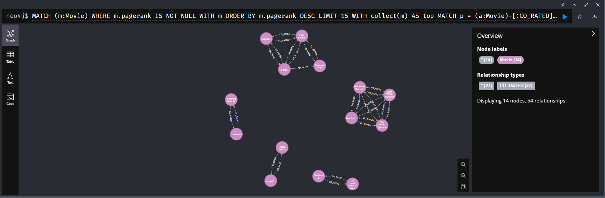

**Що означає високий PageRank?** Очікувалось, що це **центральний фільм смакового простору**: на нього як на «найсхожіший» вказують багато фільмів, які самі мають високий PageRank. Для більшої частини топу так і є — Pulp Fiction, Fargo, Shawshank, Star Wars, Raiders, Matrix: популярні *і* високо оцінені фільми, що з'єднують великі кластери аудиторії. Популярність корелює з PageRank, але не визначає його: American Beauty (№ 1 за популярністю) у топ-20 не потрапив.

**Але № 1 — Hocus Pocus** (183 оцінки, середня 2.87, лише **61** оцінка ≥ 4) і № 4 — Jungle2Jungle (середня 2.34). Це не «культові» фільми, як можна було б припустити, а наслідок **хабовості (hubness) kNN-графа**:
- На Hocus Pocus як на одного з 10 найсхожіших вказують **56** фільмів — це максимум у всьому графі (медіана — 3, p99 — 33). Серед них *Sister Act 2*, *Encino Man*, *Drop Dead Fred*, *The First Wives Club* — слабкі комедії з малою аудиторією (у середньому 50 високих оцінок).
- Jaccard на малих множинах тягне «нішеві» фільми один до одного: у малої аудиторії слабких комедій немає кращих сусідів, ніж такий самий «хвіст» каталогу, і всі вони вказують на один і той самий фільм-хаб.
- Проєкція `movieGraph` — `UNDIRECTED`, тож напрям «B у топ-10 для A» втрачається, а на неорієнтованому графі PageRank близький до **зваженого ступеня**. Звідси й результат: високий ранг = «на мене вказує багато фільмів», незалежно від того, наскільки вони самі значущі.

Тобто PageRank тут показує дві різні речі: для мейнстриму — справжню центральність смаку, а для «хвоста» каталогу — артефакт методу побудови ребер. Щоб прибрати другий ефект, можна будувати орієнтовану проєкцію (`NATURAL`), підняти `degreeCutoff` або нормувати ребра за популярністю.

### 6.2. Спільноти користувачів (Louvain)
Кроки: `User → Movie` з оцінок ≥ 4 → Node Similarity (`SIMILAR {weight}`) → проєкція `userSimilarity` → `gds.louvain.write` (зважений, `community`) → 10 найбільших спільнот → демографія → топ-3 жанри двома способами → візуалізація.

**Параметри прогону:** Node Similarity порівняв 5 950 користувачів (90 мають < 10 високих оцінок і не пройшли `degreeCutoff`), записав **59 498** ребер `SIMILAR`, Jaccard: середній 0.205, максимальний 0.571. Проєкція `userSimilarity`: 6 040 вузлів, 118 996 ребер (неорієнтовані).

**Louvain:** **107** спільнот, **modularity 0.6461**, 3 рівні, найбільша — 903 користувачі, медіана розміру — 1 (це ті самі 90 ізольованих користувачів, кожен — окрема «спільнота»; змістовних спільнот — 17).

| Спільнота | Розмір | % користувачів | % жінок | сер. код віку | top3ByCount | top3ByLift | Характер |
|---|---|---|---|---|---|---|---|
| 1116 | 903 | 15.0 | 25.1 | 30.3 | Drama, Comedy, Action | Documentary ×1.69, Film-Noir ×1.26, Drama ×1.25 | «серйозне кіно» |
| 1002 | 638 | 10.6 | 35.7 | 31.5 | Drama, Comedy, Thriller | Crime ×1.77, Documentary ×1.71, Drama ×1.65 | «кримінальна драма» |
| 2253 | 593 | 9.8 | **13.7** | 30.5 | **Action**, Drama, Adventure | Action ×1.91, Adventure ×1.75, Sci-Fi ×1.46 | «бойовики й пригоди» |
| 1913 | 506 | 8.4 | **49.4** | 31.6 | Comedy, Drama, Romance | Romance ×2.12, Comedy ×2.01, Musical ×1.15 | «романтичні комедії» |
| 203 | 500 | 8.3 | 23.4 | 27.6 | Comedy, Drama, Action | Children's ×1.20, Fantasy ×1.13, Horror ×1.12 | невиразна |
| 3854 | 470 | 7.8 | 21.7 | **27.0** | Action, Drama, Comedy | Thriller ×1.54, Action ×1.42, Crime ×1.18 | «трилери й екшн» |
| 5516 | 448 | 7.4 | 30.1 | **38.1** | Drama, Comedy, Thriller | Film-Noir ×2.86, Documentary ×2.17, Mystery ×1.93 | «класика й нуар» |
| 1244 | 435 | 7.2 | 14.3 | 30.4 | **Sci-Fi**, Action, Drama | Sci-Fi ×2.97, Fantasy ×2.07, Adventure ×1.62 | «фантастика» |
| 3222 | 422 | 7.0 | 27.5 | 28.1 | Comedy, Drama, Thriller | Animation ×1.50, Horror ×1.41, Comedy ×1.30 | «мультфільми й легкий жанр» |
| 737 | 275 | 4.6 | 28.7 | 31.3 | Drama, Comedy, Action | Horror ×1.37, Documentary ×1.21, Thriller ×1.13 | «горор» |

*«Сер. код віку» — середнє кодів MovieLens (1 = до 18, 18 = 18–24, 25 = 25–34, 35 = 35–44, 45, 50, 56+), тобто 30 ≈ «25–34», 38 ≈ «35–44».*

Дві найбільші спільноти, по 25 користувачів, підпис вузла — номер спільноти. Ребра `SIMILAR` є лише всередині спільнот (1002–1002, 1116–1116), між ними — жодного:

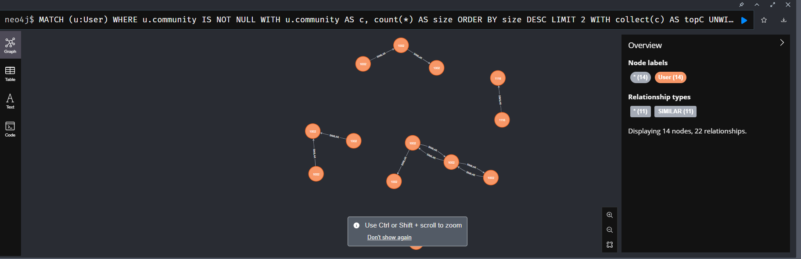

**Чи відповідають кластери інтуїтивним групам?** Так, це схоже на те, що я й очікував. Найвиразніші приклади:
- **1913 «романтичні комедії»** — єдиний кластер, де жінок майже половина (49 % при 28 % у датасеті), Romance ×2.12 і Comedy ×2.01.
- **1244 «фантастика»** і **2253 «бойовики»** — найбільш «чоловічі» (86 % чоловіків), Sci-Fi ×2.97 — найсильніший lift серед усіх спільнот.
- **5516 «класика й нуар»** — найстарша спільнота (середній код 38 ≈ 35–44 роки), Film-Noir ×2.86, Documentary, Mystery.
- **3854 «трилери»** — наймолодша (27 ≈ 18–24/25–34).

Розбиття знайшло ці групи **лише за оцінками**, без доступу до статі й віку, — тому збіг демографії з жанровим профілем є незалежним підтвердженням, що кластери реальні.

**Як це перевірено:**
1. **Сирі топ-3 жанри майже марні:** у **8 з 10** спільнот це перестановки Drama / Comedy / Action / Thriller, бо це найчисленніші жанри. Винятки — 1244 (Sci-Fi на 1-му місці) і 2253 (Action на 1-му) — саме ті спільноти, де смак настільки сильний, що пробивається навіть крізь склад каталогу. Сира частота показує склад каталогу, а не смак.
2. Тому порахований **lift** = частка жанру серед високих оцінок спільноти / частка жанру серед усіх високих оцінок. Lift 1.4 означає, що спільнота любить жанр на 40 % більше, ніж середній користувач. Саме lift показує «характер» кластера (колонка «Характер» вище). Очікуваний кластер «Children's + Animation + Musical → сімейне» у чистому вигляді **не з'явився**: найближчі — 3222 (Animation ×1.50) і 203 (Children's ×1.20, але слабкий lift — спільнота невиразна).
3. **Демографія** спільнот (частка жінок, середній вік) — незалежна перевірка: різниця між 1913 (49 % жінок) і 2253 (14 %) чи між 5516 (38) і 3854 (27) за віком показує, що розбиття відображає реальні групи, а не шум.
4. **Modularity 0.646** — значно вище порогу 0.3, тобто спільнотна структура дуже виражена: ребер `SIMILAR` усередині спільнот набагато більше, ніж очікувалось би випадково.

### 6.3. Найкоротший шлях (Dijkstra)
Проєкція `userGraph` з двома властивостями: `weight` (Jaccard-схожість) і **`cost = 1 − weight`**. Dijkstra **мінімізує** суму ваг, тож подати йому схожість напряму означало б шукати шлях через *найменш* схожих користувачів, тобто протилежне до задуманого. Окремо: незважені відстані (кількість хопів) від 10 джерел до всіх досяжних користувачів і WCC для перевірки зв'язності.

**Пари (зважений Dijkstra, `cost = 1 − Jaccard`):**
| from → to | hops | проміжних | totalCost | маршрут (userId) |
|---|---|---|---|---|
| 1 → 2 | 4 | 3 | 3.255 | 1 → 1481 → 733 → 810 → 2 |
| 1 → 3000 | 3 | 2 | 2.437 | 1 → 5975 → 3 → 3000 |
| 1 → 6040 | 5 | 4 | 3.905 | 1 → 1850 → 1057 → 1182 → 3054 → 6040 |
| 100 → 5000 | 5 | 4 | 3.785 | 100 → 2591 → 5284 → 1018 → 4889 → 5000 |
| 4169 → 1 | 5 | 4 | 3.828 | 4169 → 1088 → 4425 → 583 → 1481 → 1 |

Цікаво: у графі `RATED` users 1 і 2 на відстані **2** (обидва високо оцінили *Awakenings*, запит 6), а в графі смаку — **4**: один спільний фільм не робить їх «найсхожішими» один для одного.

**Незважені відстані від 10 джерел до всіх досяжних:**
| джерело | досяжно | avgHops | p90 | max |
|---|---|---|---|---|
| 1 | 5 949 | 3.93 | 5 | 6 |
| 100 | 5 949 | 3.67 | 5 | 6 |
| 500 | 5 949 | 3.74 | 4 | 5 |
| 1000 | 5 949 | 3.51 | 4 | 5 |
| 2000 | 5 949 | 3.56 | 4 | 5 |
| 3000 | 5 949 | 3.77 | 5 | 6 |
| 4000 | 5 949 | 3.88 | 5 | 5 |
| **4169** | 5 949 | **4.95** | **6** | **7** |
| 5000 | 5 949 | 4.28 | 6 | **7** |
| 6000 | 5 949 | 4.03 | 5 | 6 |

**WCC:** 91 компонента — одна гігантська на **5 950** користувачів і 90 ізольованих (ті, хто не пройшов `degreeCutoff: 10`).

Шлях Dijkstra 1 → 6040, підпис вузла — номер спільноти Louvain: маршрут починається в спільноті 4929 (userId 1, 1850, 1057) і переходить у найбільшу спільноту 1116 (1182, 3054, 6040). Browser додатково домальовує ребра `SIMILAR` між вузлами шляху, тому поруч з кожним `PATH_0` видно `SIMILAR`:

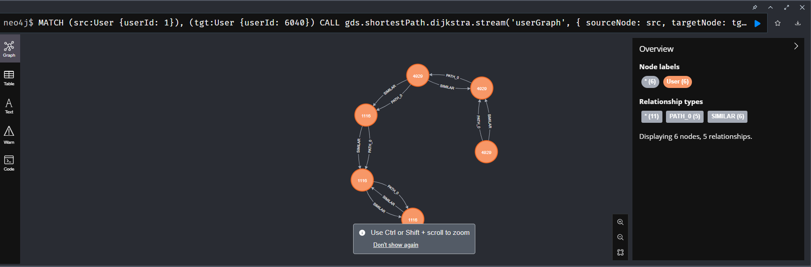

**Наскільки «тісний світ»?** Очікування (3–5 хопів) підтвердилось: середня відстань від 10 джерел — **3.5–4.95** хопа при 6 тис. вузлів, хоча кожен користувач має лише ~20 ребер (10 своїх + ті, хто обрав його). Для порівняння: у вихідному графі `RATED` 97.7 % пар на відстані 2 через блокбастери (запит 6c). Найдалі від усіх — **userId 4169**, найактивніший користувач датасету (2 314 оцінок): через величезну множину оцінок Jaccard з будь-ким у нього малий, тож у нього мало «близьких» сусідів. Тобто «важкий» користувач, який у графі `RATED` є супервузлом і з'єднує всіх, у графі смаку виявляється на периферії.

**Чи підтверджується «шість рукостискань»?** **Так, для переважної більшості пар:** середня відстань < 5 для всіх 10 джерел, p90 ≤ 6. Але не «із запасом», як очікувалось: для 2 джерел з 10 (4169 і 5000) максимальна відстань — **7** хопів, тобто окремі пари в шість рукостискань не вкладаються; ще 90 користувачів (1.5 %) недосяжні взагалі. Важливе застереження: «рукостискання» тут — не перегляд спільного фільму, а потрапляння в топ-10 найсхожіших за смаком. Це значно суворіший зв'язок, тому і «світ» тут менш тісний, ніж у графі `RATED`.

---

## 7. Частина 6 — аналіз і висновки

### 7.1. Граф vs SQL
Для порівняння візьмемо реляційну схему `users(user_id, …)`, `movies(movie_id, title, year)`, `genres`, `movie_genres(movie_id, genre)`, `ratings(user_id, movie_id, rating, ts)` з індексами по `(user_id)` і `(movie_id)`.

**Запити 1–4** у SQL пишуться без проблем: це `JOIN` + `GROUP BY` + `HAVING`, і реляційна БД виконує їх щонайменше не гірше.

**Запит 5 (рекомендації)** у SQL можливий, але це три самоз'єднання таблиці на мільйон рядків:
```sql
WITH neighbours AS (
  SELECT r2.user_id, COUNT(*) AS common_high
  FROM ratings r1
  JOIN ratings r2 ON r2.movie_id = r1.movie_id AND r2.user_id <> r1.user_id
  WHERE r1.user_id = 1 AND r1.rating >= 4 AND r2.rating >= 4
  GROUP BY r2.user_id
  ORDER BY common_high DESC
  LIMIT 50
)
SELECT m.title, COUNT(DISTINCT n.user_id) AS votes, ROUND(AVG(r.rating), 2) AS avg_rating
FROM neighbours n
JOIN ratings r ON r.user_id = n.user_id AND r.rating >= 4
JOIN movies m  ON m.movie_id = r.movie_id
WHERE NOT EXISTS (SELECT 1 FROM ratings x WHERE x.user_id = 1 AND x.movie_id = r.movie_id)
GROUP BY m.movie_id, m.title
HAVING COUNT(DISTINCT n.user_id) >= 5
ORDER BY votes DESC, avg_rating DESC
LIMIT 10;
```
Працює, але кожен «хоп» — це `JOIN` через індекс, вартість якого залежить від розміру таблиці (O(log N) на кожен рядок), а Cypher-патерн читається як сама ідея: «я → фільм ← сусід → фільм». У графі вартість залежить лише від *локального* підграфа (index-free adjacency: вузол напряму посилається на свої ребра).

**Запит 6 (найкоротший шлях)** — тут різниця принципова. У SQL змінна глибина можлива лише через рекурсивний CTE:
```sql
WITH RECURSIVE reach(user_id, depth) AS (
  SELECT 1, 0
  UNION                                   -- UNION (не ALL) прибирає дублікати
  SELECT r2.user_id, reach.depth + 1
  FROM reach
  JOIN ratings r1 ON r1.user_id = reach.user_id
  JOIN ratings r2 ON r2.movie_id = r1.movie_id
  WHERE reach.depth < 3
)
SELECT MIN(depth) FROM reach WHERE user_id = 2;
```
Проблеми: (1) немає спільної множини «вже відвіданих». `UNION` прибирає лише повністю однакові рядки, тож той самий користувач на різній глибині обробляється знову; (2) кожен рівень — `ratings ⋈ ratings` (у середньому ~165 оцінок × ~270 оцінок на фільм ≈ 45 тис. рядків *на кожного* користувача фронту), і вже на 2-му рівні фронт — майже всі 6 тис. користувачів; (3) сам шлях (які саме фільми й користувачі) не відновлюється без масиву `path` у CTE, а з ним дедуплікація зникає і кількість рядків вибухає експоненційно; (4) зупинитися «щойно знайшли» CTE не вміє, він рахує всі рівні до межі. `shortestPath` у Neo4j — це двонаправлений BFS: росте з обох кінців і зупиняється при зустрічі. Еквівалента в стандартному SQL немає. Найближче — розширення на кшталт pgRouting або Apache AGE, тобто фактично граф усередині реляційної БД.

### 7.2. Де граф програє
- **Глобальні агрегації й звіти.** «Середня оцінка по жанрах за роками», «кількість оцінок по місяцях», розподіли. Для цього треба прочитати *всі* 1M оцінок, а не локальний підграф. Колонкова СУБД (ClickHouse, DuckDB) чи PostgreSQL з `GROUP BY` зроблять це в рази швидше: вони читають одну колонку `rating` суцільним блоком, а Neo4j ходить по ребрах і читає властивість кожного окремо. Запит 4 — якраз такий випадок.
- **Часові ряди й віконні функції** по `timestamp`: `LAG`, ковзні середні, когортний аналіз. У Cypher це незручно, у SQL — стандартні засоби.
- **Експорт і ETL.** Вивантажити таблицю оцінок у CSV/Parquet для ML-моделі — це `COPY` в SQL проти обходу всіх ребер у Neo4j.
- **Масові оновлення** («перерахувати всі оцінки за формулою») і **суворі схеми / звітність** (типи, `FOREIGN KEY`, `CHECK`, BI-інструменти, які говорять SQL).
- **Ресурси.** Neo4j для продуктивності хоче тримати граф у page cache, а GDS — проєкції в heap. Для 1M оцінок це гігабайти RAM, тоді як та сама таблиця в PostgreSQL займає ~50 МБ і працює на мінімальному сервері.

**Висновок:** граф виграє там, де запит — це *обхід зв'язків змінної глибини від конкретного вузла* (рекомендації, шляхи, сусідства). Реляційна модель виграє там, де запит — це *скан і агрегація всього набору*. Реалістична архітектура: ratings у SQL/колонковому сховищі як джерело правди й аналітика, граф як похідний індекс для рекомендацій.

### 7.3. Покращення схеми під конкретні запити
1. **Запити 1 і 4 — передобчислені агрегати.** `SET m.avgRating, m.ratingCount` (і так само для `Genre`) одним батчем. Запит 1 стає `MATCH (:Genre {name:'Thriller'})<-[:HAS_GENRE]-(m) WHERE m.avgRating > 4 AND m.ratingCount >= 30`: ~490 вузлів замість ~100 тис. ребер. З індексом по `Movie.avgRating` — ще швидше. Ціна: агрегати треба оновлювати при нових оцінках.
2. **Запит 5 — матеріалізовані ребра схожості.** `(:User)-[:SIMILAR {weight}]->(:User)` (top-K, як у частині 5) перераховуються офлайн. Перший крок запиту 5 (найважчий, через блокбастери) стає одним хопом до 10–50 готових сусідів. Рекомендація — 2 хопи замість 3, і вартість не залежить від популярності фільмів користувача.
3. **Запити 3, 5, 6b — тип ребра `RATED_HIGH`.** Окремий тип для оцінок ≥ 4 (або лейбл-подібне розщеплення). Обхід не читає і не фільтрує низькі оцінки, а для щільних вузлів Neo4j відразу бере потрібну групу ребер.
4. **Запит 2 — лічильник на вузлі.** `u.fiveCount` або той самий `RATED_HIGH`/`RATED_5`. Запит перетворюється на фільтр по властивості з індексом замість агрегації по всіх ребрах.
5. **Запит 6** — шукати шлях по `SIMILAR`, а не по `RATED`. Шлях стає змістовним (через схожих людей, а не через «Зоряні війни», які бачили всі) і коротшим для обходу.

### 7.4. Підсумок курсу: яку модель для чого
- **MongoDB** — для даних, які живуть і читаються цілими документами з гнучкою структурою: профілі, каталоги, події, тобто все, що в SQL розсипалось би на десяток таблиць.
- **Векторна БД** — для пошуку за змістом, коли користувач і автор описують одне різними словами: семантичний пошук, RAG, «схожі товари».
- **Граф** — коли цінність у самих зв'язках і запит звучить як «хто пов'язаний з ким і через що»: рекомендації, шляхи, шахрайські ланцюжки, залежності.
